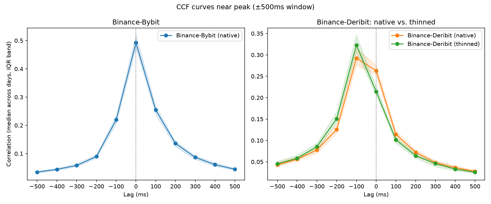

# Lead/Lag Relationships Among Binance, Bybit, OKX and Deribit

## Approach and Conclusion

The aim of this project is to determine the lead/lag relationship between the prices of BTC Perpetuals on the 4 venues: Binance, Bybit, OKX, and Deribit. We use the mid price (the average of the best bid and ask prices in the order book at every update) as an indicator for the price of the BTC Perpetual on the venues. Since this project concerns the size of the lead/lag relationships between the venues and not price prediction (extracting a signal), we have not used the micro price (volume-weighted mid price). We then compute, for each day, the correlation coefficients for the log-returns between each pair of venues after shifting one of them linearly forwards or backwards by small amounts, called lags. We fix a range of lag values, [-5s, 5s]. For each day and venue pair (venue_a, venue_b), we then compute the cross correlation function (ccf) curves: the curves passing through ordered pairs (lag, cc), where lag runs through multiples of 100ms in the interval [-5s, 5s] and where cc is the correlation coefficient between the log-returns of venue_a and those of venue_b shifted by lag. We then compute the location and height of the peaks of these ccf curves. They tell us the best lead/lag relationship on a particular day in the form of maximizing the corresponding correlation coefficient. So for each venue pair, we have a distribution of the lag values for the ccf peaks as the date varies. From this distribution, we can read off the general lead/lag relationships.

After computing the ccf curves, we found that Deribit has a moderate-to-strong lag relative to Binance, Bybit, and OKX. We also found that there is no significant lead/lag relationship between Binance, Bybit, and OKX. Here is a table for the medians and standard deviations of the best lag values for each pair across all of the 61 days. We have also listed the median ccf peak heights for each of the 6 pairs.

```text
┌─────────┬─────────┬───────────────┬────────────┬─────────────┐
│ venue_a ┆ venue_b ┆ median_lag_ms ┆ std_lag_ms ┆ median_corr │
╞═════════╪═════════╪═══════════════╪════════════╪═════════════╡
│ binance ┆ bybit   ┆ 0.0           ┆ 0.0        ┆ 0.492261    │
│ binance ┆ deribit ┆ -100.0        ┆ 17.955622  ┆ 0.292109    │
│ binance ┆ okx     ┆ 0.0           ┆ 0.0        ┆ 0.493585    │
│ bybit   ┆ deribit ┆ -100.0        ┆ 0.0        ┆ 0.318627    │
│ bybit   ┆ okx     ┆ 0.0           ┆ 0.0        ┆ 0.546285    │
│ deribit ┆ okx     ┆ 100.0         ┆ 0.0        ┆ 0.347473    │
└─────────┴─────────┴───────────────┴────────────┴─────────────┘
```

It can be seen that the ccf peak for the Binance-Deribit pair sometimes steered away from -100. In fact, on 2025-06-11 and 2025-05-10, the ccf peak for this pair was at 0. This means that on these 2 days among the 61 we tested, there was no lead/lag relationship between Binance and Deribit. This is the reason why the standard deviation of the best lag values is nonzero for the Binance-Deribit pair.

Our method shows that the strength of Deribit's lag relative to the other three venues is 100 ms. This method on its own cannot resolve changes smaller than 100 ms in size. This is because, we chose 100 ms as the grid step size since the order book update frequency for Binance is ~52 ms. However, we may still resolve the strength of the lag using the data of the ccf curves near the peak. A detailed explanation of this idea is given in Section [Block-bootstrap CI](#block-bootstrap-ci).

We have conducted a total of 5 tests, which corroborate our main statement that Deribit lags behind the other three venues and there is no lead/lag relationship between Binance, Bybit, and OKX. These tests also show that the relationships that we found are genuine and not an artifact of the data or the methodology.

A direct application of this project will be to predict the price for the lagging venue Deribit. This will involve extracting certain features like the micro price and the order flow imbalance from the order book data for Deribit. Then, we may use these features along with the micro prices for the leading venues to build a predictor for the mid price of the BTC Perp on Deribit. This is explored in a future project.

## Data cleaning and Aligning

Since the order books (with 5 levels) are updated whenever there is a change in the top 5 bid/ask prices/volumes, the order books for different venues do not have aligning timestamps. So before computing the correlation coefficients, we must first align the order books together. This is done using the scripts "clean_books.py", "run_pipeline.py", and "build_panel.py".

The first three scripts are used to remove duplicate rows and to compute the mid price and the micro price. We consider two rows in the order book to be duplicates if they have the same "timestamp" and the same 5 levels in the order book (even if they have a different "local_timestamp"). This is because the exchange cannot record two order book updates at the same time. The difference in "local_timestamp" may be attributed to an error at the data collector's end. Once we clear duplicates and compute the mid price and the micro price, we store the resulting DataFrames in .parquet files in the "btc_lead_lag_clean" folder. We found that the ratio of dropped rows to the total number of rows is at most 0.016%.

The fourth script, "build_panel.py" then builds day panels by aligning the mid-prices of the four venues to the grid of step size 100 ms. This is done via a forward-fill method. The value of the mid price in a venue at a particular grid point is equal to the most recent mid price in that venue that appeared at or before the grid point. Therefore, there is no look-ahead bias, i.e., information recorded at a grid point only uses the information known at or before the grid point. There is also a staleness criterion. We do not fill in a value if the latest update until that grid point is older than 5 seconds. In the subsequent scripts, we only use those days that have a fully-populated row. After running the script, we found that at least 99.995% of rows are fully-populated across the 61 days. The day panels are then stored in "btc_lead_lag_panel/". Each file contains the aligned mid prices of all the venues on a single day.

For one of the validation tests, we also need to build day panels with respect to the local_timestamp column. This is achieved by the same "build_panel.py" script, but with TS_COL = "local_timestamp" instead of TS_COL = "timestamp". The day panels made using timestamp are stored in "btc_lead_lag_panel/timestamp/" whereas those made using local_timestamp are stored in "btc_lead_lag_panel/local_timestamp/".

## Methodology and Robustness Checks

In this section, we first explain the method we used to conclude that Deribit lags behind Binance, Bybit, and OKX and that there is no lead/lag relationship amongst Binance, Bybit, and OKX. Then, we explain the 5 tests which we conducted to check the robustness of these relationships.

As was discussed in Section [Approach and Conclusion](#approach-and-conclusion), we use the cross correlation function (ccf) curves and identify the lag amounts based on the peaks of these ccf curves. 

For each day and pair of venues (venue_a, venue_b), we first extract the mid prices from the .parquet files containing the day panels and compute the log returns. Then, we fix a range '[-MAX_LAG_STEPS, +MAX_LAG_STEPS]' of reasonable lag values. For each value of lag_step in this range of reasonable lag values, we compute the correlation coefficient between the log returns of venue_a and those of venue_b shifted by lag_step. This means that if 't' is a variable denoting grid points, then we compute the correlation coefficient 'cc[lag_step]' of 'venue_a[t]' and 'venue_b[t - lag_step]'. Thus, for each day and pair of venues, we have curves interpolating '(lag_step, cc[lag_step])'. We call these the ccf curves. If the peak of a ccf curve occurs at some 'lag_step', then the returns venue_a[t] and venue_b[t - lag_step] have the highest correlation. In other words, venue_b leads venue_a by '|lag_step|' if 'lag_step' is positive and venue_a leads venue_b by '|lag_step|' if 'lag_step' is negative.

Next, we explain the reasons behind some of the choices we made in this methodology.

We begin with explaining why we choose log returns over raw mid prices.
One reason is that the uniform drift in the raw mid prices might produce spurious correlation because of the trend that the BTC perpetual prices share with the cost of BTC. Another reason is that the perpetual contract for Binance, Bybit, and OKX are USDT-margined and the contract for Deribit is BTC-margined. So taking log-returns yields a unit free metric which we can compare across all the 4 venues.

Next, we explain the 100 ms grid step choice. We found that the median update-rates (averaged across all days) for Binance, Bybit, OKX, and Deribit are 52 ms, 20.623 ms, 10.164 ms, and 3.164 ms, respectively. This means that a grid step of 100 ms clears all of these medians by a good margin so that we are not comparing the new data coming from the faster updating venue - Deribit with the relatively stale data coming from the slower updating venue - Binance.

Next, we explain why we chose timestamp as our primary basis. The aim of this project is to determine the actual lead/lag relationship between the BTC Perp prices on the four venues. Using local_timestamp introduces an error in the form of data travel time between the venues located at varying distances from the data collection point. Once we determine the lead/lag relationship, we may deploy the execution system at a server closer to the lagging venue and pull data from the leading venues to feed into our script.

Finally, we point out that the cross-correlation computations are done using FFT. This is because computing correlation coefficients involves computing convolutions and convolutions map to products under Fourier Transform. This means that we have to perform $864000 \times \log_2(864000) \approx 864000 \times 20$ operations instead of $864000 \times 101$ operations (when MAX_LAG_STEPS = 50). Moreover, we perform linear translations and not circular translations since we do not want to align the log returns from venue_b at the end of the day with the log returns of venue_a at the start of the day.

We also make two small approximations while computing the cross-correlation. We divide by the number of log return values that we have procured from the day panel files instead of the number of log return values that are common after shifting venue_b. The difference between these two numbers is very small since the values of 'lag_step' (~$\pm50$) are negligible as compared to the number of log return values in the panel files (~$864000$). The second approximation is that while calculating log returns, we are sometimes skipping days. This means that the log returns are sometimes computed over non-consecutive days. The fraction of such log returns is very small (~$0.005\%$).


Now that we have explained the main method of determining the lead/lag relationships, we move on to explaining the 5 robustness checks. Each one will be explained in a dedicated subsection:

### Frequency-Thinning

As is stated in the previous section, the median update rate for Binance (52 ms) is 16.4 times the median update rate for Deribit (3.164 ms) on average. This means that we might be observing spurious correlations. However, the frequency-thinning test shows that this does not happen.

In this test, we artificially slow down Deribit's book updates to match the median update rate of Binance. Then, we recompute the ccf curves for all 6 pairs of the 4 venues, but using the thinned order book for Deribit.

We run [thin_deribit.py](thin_deribit.py) to create a "thinned" clean book for Deribit followed by [build_panel_thinned.py](build_panel_thinned.py) to create day panels using the thinned clean Deribit books. Then, we run [compute_ccf_thinned.py](compute_ccf_thinned.py) to compute the ccf curves and investigate their peaks. Here is an output for the peaks of the ccf curves made using the thinned Deribit books:

```text
┌─────────┬─────────┬───────────────┬────────────┬─────────────┐
│ venue_a ┆ venue_b ┆ median_lag_ms ┆ std_lag_ms ┆ median_corr │
╞═════════╪═════════╪═══════════════╪════════════╪═════════════╡
│ binance ┆ bybit   ┆ 0.0           ┆ 0.0        ┆ 0.492261    │
│ binance ┆ deribit ┆ -100.0        ┆ 0.0        ┆ 0.323046    │
│ binance ┆ okx     ┆ 0.0           ┆ 0.0        ┆ 0.493585    │
│ bybit   ┆ deribit ┆ -100.0        ┆ 0.0        ┆ 0.339325    │
│ bybit   ┆ okx     ┆ 0.0           ┆ 0.0        ┆ 0.546285    │
│ deribit ┆ okx     ┆ 100.0         ┆ 0.0        ┆ 0.353123    │
└─────────┴─────────┴───────────────┴────────────┴─────────────┘
```

Comparing the table above with the table in Section [Approach and Conclusion](#approach-and-conclusion), we see that the strength of Deribit's lag relative to Binance increased after thinning Deribit's books. The standard deviation between the lag at which the ccf curves peaked dropped down to 0. To visualize this, see Section [Median CCF Curve Plots](#median-ccf-curve-plots).

We can also see that the median height of the ccf peaks for the Bybit-Deribit and Deribit-OKX pairs did not change much.

Both these observations corroborate the statement that Deribit's lag relative to Binance, Bybit, and OKX is not an artifact of update-rate differences.

### Placebo test

The aim of the placebo test is to compare the lead/lag relationships we found with spurious relationships that may exist just by chance between the two series of log returns. In other words, we are checking whether our result is distinguishable from the 'noise'.

Let us explain the placebo test. For each day and venue pair (venue_a, venue_b), we uniformly randomly shift the log returns from venue_b by a large offset ($\geq$ 500 steps) and compute the ccf curves between the log returns from venue_a and these shifted log returns from venue_b (after further perturbing by small offsets just like what we did in the main method). The height of the peaks of these ccf curves form the base 'noise'. We then check if the height of the peaks of the real ccf curves computed before are distinguishable from this 'noise'. Since the tables are too long to be shown here, we omit them. We have stored the tables containing the height and the location of the peak ccf before and after shifting by a large random offset in "placebo_results_timestamp.parquet". We took 20 samples from the large random offset for each day and venue pair. Then, we ran the script "summarize_placebo.py" and found that amongst the 366 (day, venue pair) tuples, the height of the real ccf curve is greater than the absolute value of the 'noise' except for a single venue pair on a single day. We also computed the z-score and found it to be large (>7) for all but a single venue pair on a single day, namely Binance-Deribit on 2025-06-06. Here, the z-score is 1.38. In other words, this corroborates the statement that the lead that Binance, Bybit, and OKX enjoy over Deribit is significantly distinguishable from any spurious relationship that might exist by a random chance.

### Peak-sharpness test

As was noted in Section [Approach and Conclusion](#approach-and-conclusion), our method cannot resolve sub-100 ms lead/lags. Therefore, using just the information of the location of the ccf curve peaks does not tell us if the ccf curve has a sharp peak (which works in favour of the claim that the location of the peak is precisely at the real lag amount) or if the ccf curve has a broad peak (which works against the claim).

In order to test if our claims regarding the lead/lag relationship are true, we compute, for each day and venue pair, the difference between the height of the peak of the ccf curve and the average height of the ccf curve above the neighbouring grid points. We also compute the difference between the height of the peak and the height of the ccf curve above zero lag. Here is a summary of the output of 'peak_sharpness.py' after running with TS_COL = "timestamp":

```text
┌─────────┬─────────┬────────────────────┬─────────────────────────┬─────────────────────────────┐
│ venue_a ┆ venue_b ┆ median_peak_lag_ms ┆ median_drop_to_zero_rel ┆ median_drop_to_neighbor_rel │
╞═════════╪═════════╪════════════════════╪═════════════════════════╪═════════════════════════════╡
│ binance ┆ bybit   ┆ 0.0                ┆ 0.0                     ┆ 0.522765                    │
│ binance ┆ deribit ┆ -100.0             ┆ 0.087554                ┆ 0.326167                    │
│ binance ┆ okx     ┆ 0.0                ┆ 0.0                     ┆ 0.551835                    │
│ bybit   ┆ deribit ┆ -100.0             ┆ 0.214719                ┆ 0.38543                     │
│ bybit   ┆ okx     ┆ 0.0                ┆ 0.0                     ┆ 0.620805                    │
│ deribit ┆ okx     ┆ 100.0              ┆ 0.425392                ┆ 0.493983                    │
└─────────┴─────────┴────────────────────┴─────────────────────────┴─────────────────────────────┘
```

The column named median_drop_to_zero_rel is an estimate of the ratio of the height of the peak of the ccf curve and the height above lag = 0. Similarly, the median_drop_to_neighbor_rel measures the ratio of the height of the peak and the average height of its neighbors.
We can see that the median_drop_to_zero_rel value for the Binance-Deribit pair is the smallest ~8.76%. The values for the Bybit-Deribit and the Deribit-OKX pairs are ~21.47 and 42.54%, respectively. Therefore, this test concludes that the lag Deribit has relative to Binance is relatively weak as compared to the lag that it has relative to Bybit or OKX.

However, if we use the thinned Deribit book instead, the numbers change to
```text
┌─────────┬─────────┬────────────────────┬─────────────────────────┬─────────────────────────────┐
│ venue_a ┆ venue_b ┆ median_peak_lag_ms ┆ median_drop_to_zero_rel ┆ median_drop_to_neighbor_rel │
╞═════════╪═════════╪════════════════════╪═════════════════════════╪═════════════════════════════╡
│ binance ┆ bybit   ┆ 0.0                ┆ 0.0                     ┆ 0.522765                    │
│ binance ┆ deribit ┆ -100.0             ┆ 0.340455                ┆ 0.42893                     │
│ binance ┆ okx     ┆ 0.0                ┆ 0.0                     ┆ 0.551845                    │
│ bybit   ┆ deribit ┆ -100.0             ┆ 0.429283                ┆ 0.460955                    │
│ bybit   ┆ okx     ┆ 0.0                ┆ 0.0                     ┆ 0.620805                    │
│ deribit ┆ okx     ┆ 100.0              ┆ 0.589533                ┆ 0.526114                    │
└─────────┴─────────┴────────────────────┴─────────────────────────┴─────────────────────────────┘
```

From the table above, we can see that thinning Deribit's book strengthened its lag. This is a strong evidence for the statement that Deribit lags behind Binance, Bybit, and OKX.

### Block-Bootstrap CI

To check the robustness of the lead/lag relationships that we claim, we may compute the Block-bootstrap confidence intervals for the location of the ccf curve peaks. 

For each day, we first draw contiguous blocks of size 100 with replacement from that day panel and try to recreate a different version of the day panel for that particular day. We then recompute the ccf curves, their peak locations and heights for this new, synthetic day panel. We then repeat this process 200 times for each day. This tells us how much the peak of the ccf curve moves if the day had evolved differently. The 2.5th - 97.5th percentiles of the resulting distribution are the 95% confidence intervals. The output of this script is too large to be shown here. Interested reader can take a look at the output stored in the file "bootstrap_peak_lag.parquet".

In the same script, we also answer the question: If venue_a leads venue_b, how can we quantify the lead in milliseconds that venue_a has over venue_b? In our method, we cannot resolve sub-100 ms leads/lags since 100 ms is the chosen grid step. We can also not reduce the grid size anymore since the median update frequency for Binance is 52 ms. So, we resort to parabolic refinements of the ccf curves: For each ccf curve (corresponding to a real day or a synthetic day), we fit a parabola through the peak and its two immediate neighbors. The location of the vertex of this parabola provides a good sub-100 ms estimate for the lead/lag relationships. The output of this script can be summarized as:

```text
┌─────────┬─────────┬─────────────────────┬────────────────────────────┐
│ venue_a ┆ venue_b ┆ real_refined_lag_ms ┆ frac_days_ci_includes_zero │
╞═════════╪═════════╪═════════════════════╪════════════════════════════╡
│ binance ┆ bybit   ┆ 3.166761            ┆ 1.0                        │
│ binance ┆ deribit ┆ -63.744664          ┆ 0.393443                   │
│ binance ┆ okx     ┆ 12.275615           ┆ 1.0                        │
│ bybit   ┆ deribit ┆ -78.066913          ┆ 0.04918                    │
│ bybit   ┆ okx     ┆ 8.405617            ┆ 1.0                        │
│ deribit ┆ okx     ┆ 93.281687           ┆ 0.0                        │
└─────────┴─────────┴─────────────────────┴────────────────────────────┘
```

The column named real_refined_lag_ms contains the locations of the vertices of the parabolas that we fit through the peak and its two immediate neighbours for the ccf curves corresponding to real days. The column names frac_days_ci_includes_zero contains the fraction of synthetic days for which the 95% confidence interval contains zero.

From the third column, we can estimate the leads Binance, Bybit, and OKX have over Deribit. More precisely, we see that Binance leads Deribit by 63.74 ms, Bybit leads Deribit by 78.07 ms, and OKX leads Deribit by 93.28 ms. The last column provides an estimate for the strength of the lead/lag relationships. Since 39.34% of the confidence intervals for the resampled days contain zero for the Binance-Deribit pair, we see that the Binance-Deribit relationship is the weakest. For the Bybit-Deribit pair, only 4.91% of confidence intervals contain zero and for the Deribit-OKX pair, none of the confidence intervals contain zero. Therefore we can conclude that the Bybit-Deribit and the Deribit-OKX relationships are strong.


### local_timestamp Sensitivity

The order book data also records the time the book update reached the data collector under the column named local_timestamp. We can therefore see if the lead/lag relationships that we found survive the flip from timestamp to local_timestamp. Thus in this 5th test, we re-compute the ccf curves and their peaks using the local_timestamp column instead of the timestamp column. Before we begin, we must rebuild the day panels using the local_timestamp column. We do so by reusing our old script "build_panel.py" but with TS_COL = "local_timestamp" instead of TS_COL = "timestamp". The outputs are stored in "btc_lead_lag_panel/local_timestamp/". We then run "compute_ccf.py" with TS_COL = "local_timestamp". The output is:

```text
┌─────────┬─────────┬───────────────┬────────────┬─────────────┐
│ venue_a ┆ venue_b ┆ median_lag_ms ┆ std_lag_ms ┆ median_corr │
╞═════════╪═════════╪═══════════════╪════════════╪═════════════╡
│ binance ┆ bybit   ┆ 0.0           ┆ 38.76509   ┆ 0.407949    │
│ binance ┆ deribit ┆ -100.0        ┆ 12.803688  ┆ 0.290811    │
│ binance ┆ okx     ┆ 0.0           ┆ 0.0        ┆ 0.490468    │
│ bybit   ┆ deribit ┆ 0.0           ┆ 0.0        ┆ 0.323754    │
│ bybit   ┆ okx     ┆ 100.0         ┆ 45.986456  ┆ 0.436       │
│ deribit ┆ okx     ┆ 100.0         ┆ 0.0        ┆ 0.338812    │
└─────────┴─────────┴───────────────┴────────────┴─────────────┘
```

Comparing this table with the one given in Section [Approach and Conclusion](#approach-and-conclusion) we see that the conclusion for the pairs not involving Bybit remains the same: Deribit lags behind Binance and OKX, no lead/lag relationship between Binance and OKX. The case for pairs involving Bybit, however, is different. On one hand, using local_timestamp instead of timestamp kills the lead Bybit had over Deribit. On the other hand, OKX gained a lead over Bybit. This lead is not strong since the standard deviation of the locations of the peaks for the Bybit-OKX ccf curves is very large (~45.99).

The table above also has some inconsistent results. It shows that Binance and Bybit do not have any lead/lag relationship. It also shows that Deribit lags behind Binance but not Bybit.

To investigate this further, we computed the average of the median differences between the values under the columns timestamp and local_timestamp for each venue across all the 61 days. We found that the gap between timestamp and local_timestamp for Deribit, Bybit, Binance, and OKX is approximately 4 ms, 38.5 ms, 2.9 ms, and 3.2 ms, respectively. This gives us a reason why changing timestamp to local_timestamp does not alter the relationships between Deribit, Binance and OKX much. The relationships involving Binance, however, are heavily changed.

We may thus conclude that the Deribit-Binance and the Deribit-OKX relationship is robust with respect to the local_timestamp sensitivity test. The Deribit-Bybit relationship, however, is not robust with respect to the local_timestamp sensitivity test.

## Median CCF Curve Plots

It might be enlightening to the reader to see the ccf curves instead of seeing some metrics associated to the ccf curves. We therefore ran a script to plot the ccf curves:



The left plot corresponds to one of the non-existent lead/lag relationships and the right plot corresponds to one of the existent lead/lag relationships. These curves are obtained by taking medians and the interquartile range of the ccf curves across days. The solid curves represent the medians and the transparent bands represent the interquartile range. Using this plot we can imagine the parabolic refinements for the Binance-Deribit native and thinned pairs. We can also see that after thinning Deribit's book, the lag that it has relative to Binance becomes clearer.


